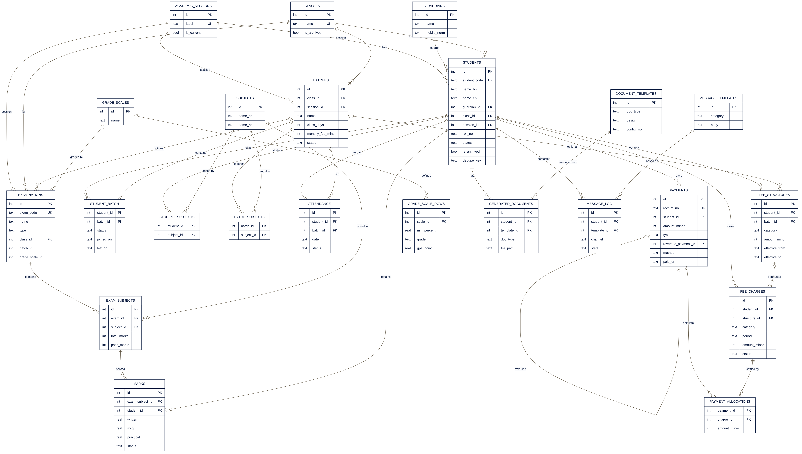

# TutorFlow — Database Schema (Phase 1)

Room database `tutorflow.db`, schema version **1**. Diagram: `er-diagram.png` / `.svg` (source `er-diagram.mmd`).

Conventions (see architecture D3–D7): ids are `INTEGER PRIMARY KEY AUTOINCREMENT`; money is `INTEGER` minor units; dates are `TEXT yyyy-MM-dd`; timestamps are UTC epoch-millis; `*_at` columns are `INTEGER`; enums are stored as `TEXT` constants. `PRAGMA foreign_keys = ON` is set on every open.



The 18 entities required by the spec are marked ★. The extra tables exist only to meet other spec rules (cited in the "Why" column).

---

## 1. People and academic structure

| Table | Columns (beyond id) | Keys / constraints | Why |
|---|---|---|---|
| ★ `academic_sessions` | label, start_date, end_date, is_current | UNIQUE(label) | §7, §9, §13 |
| ★ `guardians` | name, mobile_norm, alt_mobile, whatsapp_mobile, relation | UNIQUE(mobile_norm, name_norm) | siblings share one guardian row |
| ★ `students` | student_code, photo_path, name_bn, name_en, father_name, mother_name, guardian_id, alt_mobile, gender, dob, present_address, permanent_address, institution_name, class_id, section, group_name, session_id, roll_no, registration_no, admission_date, blood_group, emergency_contact, notes, status, is_archived, archived_at, dedupe_key, created_at, updated_at | UNIQUE(student_code); FK guardian→guardians RESTRICT; FK class→classes RESTRICT; FK session→academic_sessions RESTRICT; INDEX(name_en), INDEX(name_bn), INDEX(roll_no), INDEX(status, is_archived), INDEX(dedupe_key), INDEX(guardian_id) | §9. `status` ∈ ACTIVE, INACTIVE, GRADUATED, TRANSFERRED |
| ★ `classes` | name, level_order, is_archived | UNIQUE(name) | §10 |
| ★ `subjects` | name_en, name_bn, code, is_archived | UNIQUE(name_en) | §13 |
| ★ `batches` | class_id, session_id, name, location, class_days (bitmask Mon=1…Sun=64), start_min, end_min, capacity, monthly_fee_minor, status, notes, created_at | UNIQUE(session_id, name); FK class RESTRICT; FK session RESTRICT; INDEX(class_id), INDEX(status) | §10. `status` ∈ ACTIVE, PAUSED, COMPLETED, ARCHIVED |
| ★ `student_batch` (StudentBatchCrossRef) | student_id, batch_id, joined_on, left_on, status, fee_override_minor | **PK(student_id, batch_id)**; FK student RESTRICT; FK batch RESTRICT; INDEX(batch_id) | §9 many-to-many. Leaving a batch sets `status=LEFT`, `left_on`; the row is **never deleted** |
| `batch_subjects` | batch_id, subject_id | PK(both); FK RESTRICT | §10 "assign subjects" |
| `student_subjects` | student_id, subject_id | PK(both); FK RESTRICT | §9 "Subjects" |
| `id_sequences` | name (PK), next_value | — | gap-free student/exam/receipt numbers generated inside a transaction |

**Duplicate detection.** `dedupe_key = normalise(name_en) + "|" + guardian.mobile_norm + "|" + dob`. Before inserting, the repository searches by `dedupe_key`, and by (guardian mobile + similar name) as a softer match, and returns `DuplicateWarning(candidates)`. The owner may open the existing profile (the normal path for adding a student to another batch) or explicitly confirm a genuinely different student (e.g. twins). Registering the *same* student into a second batch never creates a second student row — it adds a `student_batch` row.

**Student ID format:** `<prefix><session-year>-<4-digit sequence>` (e.g. `TF26-0001`), prefix configurable in settings.

---

## 2. Attendance

| Table | Columns | Keys / constraints |
|---|---|---|
| ★ `attendance` | student_id, batch_id, date, status (PRESENT, ABSENT, LATE, LEAVE), remark, marked_at, updated_at | **UNIQUE(student_id, batch_id, date)**; FK RESTRICT both; INDEX(batch_id, date), INDEX(student_id, date) |

Saving a day uses `INSERT … ON CONFLICT(student_id,batch_id,date) DO UPDATE`, so editing and re-saving can never create duplicates.

**Percentage (default, configurable in Settings):** `(PRESENT + LATE) ÷ (PRESENT + LATE + ABSENT) × 100`. LEAVE is excused and excluded from the denominator. If the denominator is 0 the result is "no data", not 0 %.

---

## 3. Fees and payments (the ledger)

```
fee_structures  ── "what the plan is"    (versioned, never edited in place)
fee_charges     ── "what is owed"        (one row per student/category/month; void, never delete)
payments        ── "what was paid"       (append-only; corrections = reversal rows)
payment_allocations ── which payment settled which charge
```

| Table | Columns | Keys / constraints |
|---|---|---|
| ★ `fee_structures` | student_id, batch_id?, category (MONTHLY, ADMISSION, EXAM, ADDITIONAL, SPECIAL), amount_minor, discount_minor, scholarship_minor, effective_from (yyyy-MM), effective_to?, note, created_at | FK student RESTRICT; FK batch SET NULL; INDEX(student_id, category, effective_from) |
| `fee_charges` | student_id, batch_id?, structure_id?, category (above + PREVIOUS_DUE), period (yyyy-MM, NULL for one-offs), description, amount_minor, discount_minor, scholarship_minor, due_date, status (ACTIVE, VOIDED), void_reason, created_at | **UNIQUE(student_id, batch_id, category, period)** makes monthly generation idempotent; FK student RESTRICT; INDEX(student_id, period), INDEX(status) |
| ★ `payments` | receipt_no, student_id, amount_minor (**signed**), type (PAYMENT, REVERSAL), reverses_payment_id?, corrected_from_id?, method (CASH, BKASH, NAGAD, BANK, OTHER), transaction_ref, paid_on, remarks, created_at | **UNIQUE(receipt_no)**; **UNIQUE(reverses_payment_id)** (a payment can be reversed once); FK student RESTRICT; INDEX(student_id, paid_on), INDEX(paid_on) |
| `payment_allocations` | payment_id, charge_id, amount_minor (signed) | PK(payment_id, charge_id); FK RESTRICT |

### Formulas (domain `FeeCalculator`, pure Kotlin)

```
charge.net          = amount − discount − scholarship                (never below 0)
Total Payable       = Σ net of ACTIVE charges            (Previous Due + Monthly + Additional … − Discounts)
Total Payments      = Σ signed payments (PAYMENT +, REVERSAL −)
Remaining Due       = Total Payable − Total Payments
   > 0  → due        = 0 → settled        < 0 → advance credit
payment status      = derived: UNPAID / PARTIAL / PAID / ADVANCE   (never stored)
```

Advance payment: a payment larger than current dues leaves a negative Remaining Due (credit). When the next monthly charge is generated, available credit is auto-allocated to it.

### Immutability rules (enforced in the database, not only in code)

Created by `RoomDatabase.Callback.onCreate/onOpen` and re-created after any restore or migration:

```sql
CREATE TRIGGER IF NOT EXISTS payments_no_update BEFORE UPDATE ON payments
BEGIN SELECT RAISE(ABORT, 'payments are immutable; create a reversal'); END;
CREATE TRIGGER IF NOT EXISTS payments_no_delete BEFORE DELETE ON payments
BEGIN SELECT RAISE(ABORT, 'payments cannot be deleted'); END;
CREATE TRIGGER IF NOT EXISTS allocations_no_update BEFORE UPDATE ON payment_allocations
BEGIN SELECT RAISE(ABORT, 'allocations are immutable'); END;
CREATE TRIGGER IF NOT EXISTS allocations_no_delete BEFORE DELETE ON payment_allocations
BEGIN SELECT RAISE(ABORT, 'allocations cannot be deleted'); END;
CREATE TRIGGER IF NOT EXISTS payments_sign_check BEFORE INSERT ON payments
WHEN (NEW.type='PAYMENT' AND NEW.amount_minor <= 0) OR (NEW.type='REVERSAL' AND NEW.amount_minor >= 0)
BEGIN SELECT RAISE(ABORT, 'payment sign does not match type'); END;
```

(`CHECK` constraints are not expressible through Room annotations, hence triggers. A restore into a temporary DB drops and re-creates these triggers in the same transaction.)

### Correction and reversal
1. **Reverse**: insert a REVERSAL row (negative amount, `reverses_payment_id` = original) plus mirrored negative allocations. Original stays visible, marked "reversed" in the UI.
2. **Correct**: reverse the wrong payment, then insert a new PAYMENT with `corrected_from_id` = original. Both appear in history and on the student ledger.
3. **Fee change**: close the current `fee_structures` row (`effective_to`) and insert a new one. Existing `fee_charges` and payments are untouched, so past transactions never change.

---

## 4. Examinations and results

| Table | Columns | Keys / constraints |
|---|---|---|
| ★ `examinations` | exam_code, name, type (WEEKLY, MONTHLY, CLASS_TEST, MODEL, HALF_YEARLY, ANNUAL, SPECIAL, CUSTOM), class_id, batch_id?, session_id, exam_year, remarks, grade_scale_id, status | UNIQUE(exam_code); FKs RESTRICT; INDEX(class_id), INDEX(batch_id), INDEX(session_id) |
| `exam_subjects` | exam_id, subject_id, exam_date, start_min, end_min, venue, total_marks, pass_marks, written_max, mcq_max, practical_max | UNIQUE(exam_id, subject_id); FK exam RESTRICT; FK subject RESTRICT |
| ★ `marks` | exam_subject_id, student_id, written?, mcq?, practical?, status (ENTERED, ABSENT, WITHHELD, MISSING), updated_at | **UNIQUE(exam_subject_id, student_id)**; FK RESTRICT; INDEX(student_id) |
| `grade_scales` | name, uses_gpa, is_default | — |
| `grade_scale_rows` | scale_id, min_percent, grade, gpa_point | UNIQUE(scale_id, min_percent) |

Totals, grade, GPA, pass/fail and position are **computed** by `ResultCalculator`. Because each exam stores its `grade_scale_id`, editing a grading scale later creates a *new* scale for future exams; **historical results keep the scale they were graded with.** A saved result cannot silently change.

Result states: complete, incomplete (some MISSING), withheld, absent. Absent/withheld/missing are excluded from pass-percentage and averages as defined in the calculator spec, and are shown explicitly on marksheets.

**Merit position:** ranked by total obtained descending, tie-break by (1) higher marks in the first subject then later subjects in exam order (configurable), (2) roll number. Students who tie on every key share a position (standard competition ranking 1,2,2,4). Failed students are listed after passed students unless the owner chooses otherwise.

---

## 5. Documents, messaging, calendar, system

| Table | Columns | Notes |
|---|---|---|
| ★ `document_templates` | doc_type, design (CLASSIC_ACADEMIC, MODERN_PREMIUM, MINIMAL_WHITE, NAVY_GOLD, PROFESSIONAL), name, width_mm, height_mm, config_json, is_default, is_builtin | Built-in templates are seeded by app code, not as sample data |
| `generated_documents` | student_id?, exam_id?, payment_id?, template_id, doc_type, file_path, format, created_at | Feeds the profile's "Generated Documents" list |
| ★ `message_templates` | category (10 categories), language, title, body, is_builtin | Variables in `{braces}` |
| `message_log` | student_id, template_id?, channel (WHATSAPP, SMS), state (PREPARED, OPENED_IN_APP), body_snapshot, created_at | **No DELIVERED state** by design |
| ★ `notifications` | kind, title, body, fire_at, ref_type, ref_id, status (SCHEDULED, FIRED, DISMISSED, CANCELLED) | Rebuilt by WorkManager after reboot |
| `calendar_events` | title, kind (HOLIDAY, EVENT, FEE_DEADLINE, ADMISSION_DEADLINE, REMINDER), date, start_min?, end_min?, note | Class and exam times are read from batches/exam_subjects, not duplicated |
| ★ `expenses` | category (RENT, ELECTRICITY, INTERNET, STATIONERY, PRINTING, TEACHING_MATERIALS, OTHER), amount_minor, date, method, description, receipt_path, is_voided | Kept separate from `payments` (spec §23) |
| ★ `app_settings` | single row (id = 1): db_uuid, teacher_name, institution_name, institution_address, logo_path, phone, email, signature_path, currency_code, currency_symbol, date_format, current_session_id, attendance_rule_json, id_prefix, default_template_json | UI prefs (theme, language, lock flags) live in DataStore; institution/business settings live here so they travel inside backups |
| ★ `backup_history` | kind (LOCAL, DRIVE), scope, file_name, location_uri, size_bytes, sha256, db_schema_version, app_version, status (OK, FAILED), error, created_at | Drives "last backup" and history lists |
| `activity_log` | kind, summary_key, args_json, ref_type, ref_id, created_at | "Recent Activity" on the dashboard; also records batch removals |

---

## 6. Delete / archive policy

| Record | Archive | Hard delete allowed when |
|---|---|---|
| Student | always (status unchanged; `is_archived=1`) | never has enrolments, attendance, charges, payments, marks or documents (e.g. mistaken just-created record) |
| Batch / class / subject | always | no dependents |
| Payment, allocation | **not allowed** | never |
| Fee charge | VOID with reason | never |
| Marks | edit in place until exam is "published"; afterwards correction keeps an `activity_log` entry | exam has no marks |
| Expense | VOID | never |

All foreign keys that point at history use `RESTRICT`, so the database itself refuses a destructive delete even if app code is wrong.

---

## 7. Migrations

- `exportSchema = true`; JSON schemas committed under `app/schemas/`.
- Every version bump ships an explicit `Migration(n, n+1)` plus a `MigrationTestHelper` test that opens the previous schema JSON, inserts rows, migrates and validates.
- `fallbackToDestructiveMigration()` is **never** enabled.
- After migration, `onOpen` re-creates triggers and runs `PRAGMA foreign_key_check`.
- Version 1 is the baseline; no scripts exist yet (nothing to migrate from).

## 8. Query/performance plan (target: smooth with 1,000+ students, 100,000+ attendance rows)

- Indexes listed above cover: student search (name/ID/roll/guardian phone via join), batch roster, attendance by (batch, date) and (student, date), ledger by student, collections by date.
- Search uses indexed prefix match plus `LIKE` on normalised columns; if measured slow, add an FTS4 virtual table in a later migration (decision made from measurement, not assumed).
- Lists use `PagingSource`/lazy lists; aggregate figures (dashboard, ledger) are single SQL `SUM`/`COUNT` queries, not loaded-then-summed in Kotlin.
- A debug-only seeder (`src/debug`) creates 1,000+ students with attendance, payments and marks for performance checks. Production builds contain no seed data. Built-in message/document templates and the default grade scale are *configuration*, installed at first run, and are not sample records.
