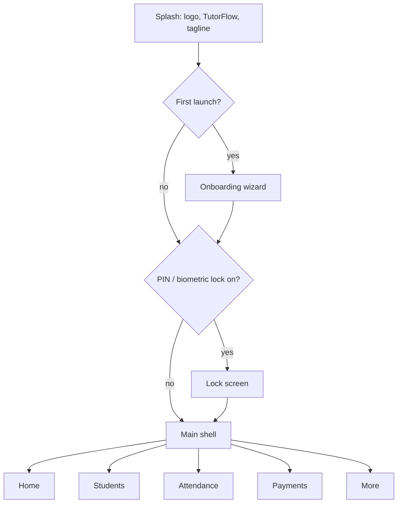

# TutorFlow — Navigation Structure (Phase 1)

## 1. App flow

**Onboarding (spec §7), 4 short steps, nothing mandatory except the teacher name:**
1. Teacher name · language · theme
2. Institution name, address, logo (Photo Picker)
3. Phone, email, academic session
4. Review → finish. No online account, no network needed.

## 2. Shell

Floating **glass capsule tab bar** with the five main destinations (Home, Students, Attendance, Payments, More) and a separate circular **Search** button on its right that opens Global Search (spec §20). This follows the layered floating-bar idea in the supplied reference screenshot, but uses TutorFlow's own icons, navy/gold selection pill and layout — it is not a copy of Apple's design.

- Selected tab: gold pill behind the icon, navy icon/label. Unselected: secondary text colour.
- Bar hides while scrolling down long lists and reappears on scroll up; hidden on full-screen flows (forms, preview, marks entry).
- A contextual **FAB** per tab (Add Student, Take Attendance, Collect Fee).
- Back stack: each tab keeps its own stack (`saveState/restoreState`); More-hub items push onto the More stack.

## 3. Route map

| Area | Route | Arguments | Reached from |
|---|---|---|---|
| Boot | `splash`, `onboarding`, `lock` | — | app start |
| Home | `home` | — | tab |
| Students | `students` (list, search, filter, sort) | filter? | tab, dashboard |
| | `student/{id}` (profile) | id | list, search, QR scan later |
| | `student/edit?id=` (registration/edit form) | id? | FAB, profile |
| | `student/{id}/ledger` | id | profile, payments |
| | `student/{id}/documents` | id | profile |
| Attendance | `attendance` (pick batch + date) | batchId?, date? | tab, quick action |
| | `attendance/take/{batchId}/{date}` | batchId, date | above |
| | `attendance/history`, `attendance/calendar/{studentId}` | — | above |
| Payments | `payments` (overview, today, dues) | — | tab |
| | `payments/collect?studentId=` | studentId? | FAB, profile |
| | `payments/{id}` (detail, reverse/correct) | id | list |
| | `payments/receipt/{id}` | id | detail |
| More hub | `more` (grid of 12 items) | — | tab |
| Batches | `batches`, `batch/{id}`, `batch/edit?id=`, `batch/{id}/students` | — | More |
| Classes | `classes`, `class/edit?id=` | — | More |
| Examinations | `exams`, `exam/{id}`, `exam/edit?id=` | — | More, quick action |
| Results | `results`, `marks/{examSubjectId}`, `result/{examId}`, `merit/{examId}`, `marksheet/{examId}/{studentId}`, `exam-compare` | — | More, exam detail |
| Documents | `documents` (15 types), `document/preview/{type}`, `document/bulk`, `idcard/designer`, `templates` | type, ids | More, profile |
| Messages | `messages` (center), `messages/compose`, `messages/bulk`, `messages/templates` | category?, studentId? | More, quick action |
| Calendar | `calendar` (day, week, month, agenda), `calendar/event/edit?id=` | date? | More |
| Reports | `reports`, `reports/{type}` | filters | More |
| Expenses | `expenses`, `expense/edit?id=` | — | More |
| Backup & Restore | `backup`, `backup/restore/review`, `backup/drive` | — | More, quick action |
| Settings | `settings` + `settings/{profile,institution,language,theme,grading,sessions,currency,notifications,security,data}` | — | More |
| About | `about` | — | More |
| Search | `search` | query? | search button |

Type-safe (`@Serializable`) route classes live in `core/navigation/Routes.kt`; ViewModels receive arguments through `SavedStateHandle`.

## 4. Dashboard quick actions → destination

| Quick action | Destination |
|---|---|
| Add Student | `student/edit` |
| Take Attendance | `attendance` |
| Collect Fee | `payments/collect` |
| Add Examination | `exam/edit` |
| Enter Marks | `results` (choose exam → subject) |
| Generate ID Card | `documents` pre-filtered to ID card |
| Generate Admit Card | `documents` pre-filtered to admit card |
| Send Parent Message | `messages/compose` |
| Create Backup | `backup` (confirm dialog) |

## 5. Navigation rules

- Destructive or irreversible actions (delete, reverse payment, restore, overwrite backup) always open a confirmation dialog stating exactly what will change.
- Unsaved form changes prompt before leaving.
- Every screen is reachable in ≤ 3 taps from Home.
- System back from a tab root goes to Home; from Home exits.
- Locking: when the lock is enabled the app returns to `lock` after the configured background timeout, then restores the previous destination.
